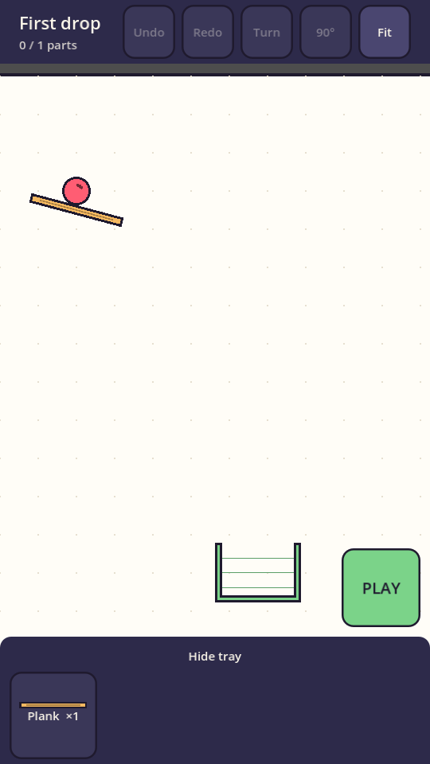

# Tinker

Daily Rube Goldberg contraption puzzle for iOS and Android. Every day the whole world gets the same goal and the same parts; build the machine that solves it in the fewest pieces. Godot 4.5, GDScript, deterministic 60 Hz physics.

- `docs/PROGRESS.md` — what is done, what is next, decisions, open questions. **Start here.**
- `docs/DESIGN.md` — architecture, determinism rules, level/part JSON, touch controls, testing.
- `docs/STORE.md` — store readiness checklist.

## Quick start

```bash
bash tools/setup.sh                       # Godot 4.5.1, export templates, Android SDK (Linux)
godot --headless --path game --import
godot --headless --fixed-fps 60 --path game -s res://tests/run_tests.gd -- --replays=100   # tests + determinism
godot --path game                         # play on desktop (mouse acts as touch)
```


